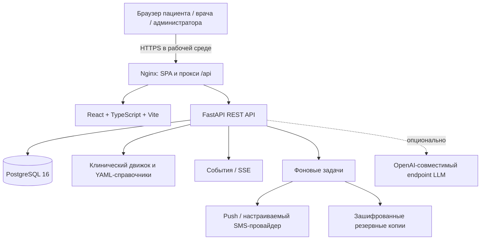

 Клинический компас (Kompas)

> Статус проекта: демонстрационный прототип / основа для дальнейшей разработки. Код содержит медицинские сценарии и правила поддержки клинических решений, однако это само по себе не подтверждает клиническую валидность, медицинскую регистрацию или соответствие конкретному правовому режиму. В репозитории явно отмечено, что клинические справочники и шкалы требуют проверки квалифицированными специалистами. Не используйте приложение для постановки диагноза, назначения/изменения лечения или экстренного наблюдения за реальными пациентами без отдельной клинической, юридической, информационно-безопасностной и эксплуатационной валидации.

«Клинический компас» — веб-приложение для структурированного сопровождения пациентов с тревожной и депрессивной симптоматикой. Оно объединяет кабинет врача, кабинет пациента, опросники, дневник самочувствия, историю наблюдения, терапевтические назначения и отметки о приёме препаратов, сообщения, сигнальные события, настраиваемые клинические справочники и административные инструменты.

Интерфейс приложения на русском языке. Backend предоставляет REST API и события в реальном времени; frontend — адаптивное React-приложение с PWA-оболочкой. Для локальной демонстрации можно использовать SQLite, а `docker-compose.yml` поднимает PostgreSQL, API и веб-интерфейс.

 Содержание

- [Возможности](возможности)
- [Что важно знать перед использованием](что-важно-знать-перед-использованием)
- [Архитектура](архитектура)
- [Стек технологий](стек-технологий)
- [Структура репозитория](структура-репозитория)
- [Быстрый запуск через Docker Compose](быстрый-запуск-через-docker-compose)
- [Первоначальная настройка и демо-данные](первоначальная-настройка-и-демо-данные)
- [Локальная разработка без Docker](локальная-разработка-без-docker)
- [Переменные окружения](переменные-окружения)
- [Роли и основные сценарии](роли-и-основные-сценарии)
- [API](api)
- [Справочники и клинические правила](справочники-и-клинические-правила)
- [События, уведомления и офлайн-режим](события-уведомления-и-офлайн-режим)
- [Безопасность и персональные данные](безопасность-и-персональные-данные)
- [Резервное копирование и восстановление](резервное-копирование-и-восстановление)
- [Тесты и проверки качества](тесты-и-проверки-качества)
- [Диагностика проблем](диагностика-проблем)
- [Подготовка к развёртыванию](подготовка-к-развёртыванию)
- [Документация проекта](документация-проекта)
- [Лицензия](лицензия)

 Возможности

 Кабинет врача

- Список пациентов и карточка пациента с историей наблюдения.
- Редактирование профильных данных и диагнозов, фиксация визитов и плана наблюдения.
- Просмотр шкал, дневника, истории, данных о терапии и сообщений.
- Назначение опросников и планов мониторинга.
- Регистрация назначения, изменение статуса терапии, планирование доз и расчёт показателей приверженности.
- Просмотр рекомендаций и объяснений движка правил; предупреждения и маршрутизация к специалистам.
- Приём сообщений от пациентов и двусторонняя переписка.
- Очередь алертов: подтверждение доставки, подтверждение получения/начала работы, разрешение алерта.
- Разбор зарегистрированных нежелательных явлений и подготовка данных для фармаконадзорного отчёта.
- Загрузка документа с историей болезни и применение извлечённых сведений после проверки врачом.
- Экспорт части клинических данных в FHIR R4.
- Живые обновления через Server-Sent Events (SSE).

 Кабинет пациента

- Согласие на обработку данных и возможность отозвать согласие.
- Самооценка по назначенным шкалам, дневник самочувствия, отметки о приёме доз и регистрация нежелательных реакций.
- Просмотр истории и сообщений, отправка сообщения врачу.
- Экспорт данных и календарь напоминаний о дозах в формате ICS.
- Управление доверенными контактами при наличии отдельного согласия.
- Ограниченная офлайн-очередь для поддерживаемых действий пациента: заполнение шкалы, запись дневника, отметка дозы, нежелательная реакция и сообщение врачу. Переданные офлайн-операции имеют `client_id` для идемпотентной синхронизации.
- Push-уведомления браузера при наличии разрешения и активной подписки.

 Клинический движок

- Подсчёт и интерпретация шкал, заданных в справочниках. В репозитории есть PHQ-9, GAD-7, HAM-A, C-SSRS и ITT.
- Правила алертинга, оценки рисков, маршрутизации и контроля нежелательных явлений.
- Справочники препаратов, классов лекарств, кодов состояний, политик ответа и плана мониторинга.
- Рекомендации, проверки условий и противопоказаний, формирование предлагаемых клинических действий.
- Детерминированное извлечение структурированных сведений из текста; опционально — подключение совместимого с OpenAI API языкового сервиса через `LLM_URL`.
- Хранение справочников в YAML в репозитории с первоначальной загрузкой в БД, проверкой схем, историей версий и процессом клинического рецензирования.

 Администрирование и наблюдаемость

- Управление пользователями и ролями, активацией учётных записей и назначением лечащего врача.
- Просмотр аудита, проверка целостности его хэш-цепочки, просмотр очередей уведомлений.
- Административная сводка состояния, метрик, фоновых задач, очередей и резервных копий.
- Единый формат ошибок (Problem Details), идентификатор запроса `X-Request-ID`, журналы доступа и метрики API.
- Фоновые задачи: эскалация не подтверждённых алертов, отправка уведомлений, напоминания, обслуживание данных и резервное копирование с периодической проверкой восстановления.

 Архитектура



 Компоненты

- Frontend: `frontend/` — React 18, TypeScript, React Router, Vite, Vitest. API-запросы идут через `frontend/src/api/client.ts`; в режиме разработки Vite проксирует `/api` на backend.
- Backend: `backend/app/` — FastAPI, SQLAlchemy 2, Pydantic 2. Маршруты сгруппированы по аутентификации, пациенту, врачу, справочникам, администрированию, аналитике, push-уведомлениям и состоянию системы.
- Клинический движок: `backend/app/engine/` — вычисление шкал, правила, алерты, рекомендации, извлечение из текста, контекст и FHIR.
- Справочники: `backend/knowledge/` — YAML-файлы по категориям: шкалы, препараты, рекомендации, правила и словари.
- База данных: PostgreSQL в Docker Compose; для локального запуска без `DATABASE_URL` backend использует SQLite-файл `backend/data/app.db`.
- События: потоковые обновления SSE и таблица событий позволяют передавать события нескольким рабочим процессам. Для одноразовой авторизации SSE используется отдельный краткоживущий тикет вместо токена в URL.
- Уведомления и фоновые задачи: `backend/app/jobs.py`, `backend/app/notify.py`, `backend/app/webpush.py`.
- Эксплуатационные инструменты: скрипты резервного копирования и проверки восстановления, замера задержки алертов, нагрузочного тестирования и проверки покрытия API во frontend-документации.

 Стек технологий

| Слой | Технологии |
|---|---|
| Frontend | React 18, TypeScript 5, React Router 7, Vite 6, Vitest, ESLint |
| Backend | Python 3.12, FastAPI, Uvicorn, Pydantic 2, SQLAlchemy 2 |
| База данных | PostgreSQL 16 в Docker Compose; SQLite для разработки и тестов |
| Валидация и справочники | PyYAML, JSON Schema, схемы движка |
| Криптография и аутентификация | `cryptography`, Argon2, TOTP (`pyotp`), непрозрачные токены с хэшированием на сервере |
| Сеть и интеграции | HTTPX, Web Push, SMS.ru как опциональный SMS-провайдер |
| Развёртывание | Docker Compose, Nginx |

Точные версии Python-зависимостей закреплены в `backend/requirements.txt`, JavaScript-зависимостей — в `frontend/package-lock.json` и `frontend/package.json`.

 Структура репозитория

```text
.
├── README.md
├── .env.example                  пример локальной конфигурации
├── .gitignore
├── docker-compose.yml            PostgreSQL + API + Nginx/frontend
├── backend/
│   ├── Dockerfile
│   ├── requirements.txt
│   ├── app/
│   │   ├── api/                  REST API по доменам
│   │   ├── engine/               шкалы, правила, рекомендации, алерты, FHIR
│   │   ├── main.py               создание FastAPI-приложения и middleware
│   │   ├── config.py             конфигурация из переменных окружения
│   │   ├── models.py             модели SQLAlchemy
│   │   ├── db.py                 движок БД и сессии
│   │   ├── auth.py               аутентификация, роли и аудит
│   │   ├── crypto.py             шифрование данных и ключи пациентов
│   │   ├── jobs.py               фоновые задачи
│   │   ├── backup.py             резервные копии SQLite
│   │   ├── backup_postgres.py    резервные копии PostgreSQL
│   │   ├── notify.py             очередь уведомлений
│   │   ├── webpush.py            отправка Web Push
│   │   └── seed.py               синтетические демо-данные
│   ├── knowledge/
│   │   ├── dictionaries/
│   │   ├── drugs/
│   │   ├── guidelines/
│   │   ├── rules/
│   │   └── scales/
│   ├── tests/                    backend-тесты
│   └── tools/                    инструменты нагрузочных/латентностных проверок
├── frontend/
│   ├── Dockerfile
│   ├── nginx.conf
│   ├── package.json
│   ├── public/                   app icon, manifest, Service Worker
│   └── src/
│       ├── api/                  клиент API, типы, SSE и офлайн-очередь
│       ├── auth/                 контекст авторизации
│       ├── components/
│       └── pages/                экраны по ролям
├── docs/
│   ├── compliance.md             реестр нормативных вопросов и стандартов
│   ├── frontend-backend-coverage.md
│   └── requirements_matrix.md    матрица требований, статусов и оставшихся задач
└── tools/
    └── check_route_coverage.py   проверка покрытия маршрутов документацией
```

 Быстрый запуск через Docker Compose

 Требования

- Docker Engine и Docker Compose v2 (`docker compose`).
- Свободный локальный порт `8081` по умолчанию.
- Для первого запуска — доступ к registry для загрузки базовых образов и кэширования зависимостей.

 1. Создайте файл окружения

В корне репозитория:

```bash
cp .env.example .env
```

Откройте `.env` и замените все значения `CHANGE_ME` / `REPLACE_WITH_...`. Не добавляйте `.env` в Git и не публикуйте его содержимое.

Сгенерировать мастер-ключ длиной 32 байта можно так:

```bash
python -c "import os,base64; print('k1:'+base64.urlsafe_b64encode(os.urandom(32)).decode().rstrip('='))"
```

Сгенерируйте пароль базы и пароль демо-учётных записей отдельно — длинные, уникальные и случайные. Значение `MASTER_KEYS` имеет вид `идентификатор:base64url-ключ`; например, `k1:...`. Используйте результат команды целиком после `MASTER_KEYS=`.

Для локального запуска `.env.example` задаёт `APP_ENV=development`. Это намеренно: в production включены дополнительные проверки конфигурации и клинических справочников.

 2. Соберите и запустите сервисы

```bash
docker compose up --build -d
```

Проверить состояние контейнеров и журналы:

```bash
docker compose ps
docker compose logs -f api
docker compose logs -f web
docker compose logs -f db
```

Откройте интерфейс: <http://localhost:8081>

При стандартной конфигурации API доступен через Nginx по префиксу `/api`; порт backend напрямую на хост не публикуется. PostgreSQL использует постоянный Docker volume `pgdata`, а каталог `/app/data` backend хранится в volume `apidata`.

 3. Загрузите демонстрационные записи

Первый запуск загружает YAML-справочники в БД, но не создаёт демо-пользователей автоматически. Для синтетических сценариев выполните:

```bash
docker compose exec api python -m app.seed
```

Войдите в приложение под одним из логинов из следующего раздела. Пароль для всех созданных seed-учётных записей берётся из `DEMO_PASSWORD` в `.env`.

 4. Остановите сервисы

```bash
docker compose down
```

Данные в томах сохраняются. Чтобы удалить контейнеры и безвозвратно удалить тома базы/данных, команда выглядит так:

```bash
docker compose down -v
```

Не используйте `-v`, если требуется сохранить базу или резервные копии.

 Полезные URL

| URL | Назначение |
|---|---|
| `http://localhost:8081/` | Веб-интерфейс |
| `http://localhost:8081/about` | Страница «О сервисе» |
| `http://localhost:8081/api/health` | Liveness-проверка: процесс отвечает |
| `http://localhost:8081/api/ready` | Readiness-проверка: БД, справочники, события и фоновые задачи |

В локальном режиме без Docker Swagger UI и OpenAPI доступны на backend-порту: `http://localhost:8000/docs` и `http://localhost:8000/openapi.json`, если `DOCS_ENABLED=1`. В текущем Docker Compose порт API не опубликован напрямую, а Nginx проксирует `/api/`, но не `/docs` и `/openapi.json`; при необходимости документацию следует открыть отдельным защищённым маршрутом reverse proxy. В production Swagger/OpenAPI по умолчанию выключены (`DOCS_ENABLED=0`, если не переопределено).

 Первоначальная настройка и демо-данные

 Демо-учётные записи

`backend/app/seed.py` содержит синтетические сценарии и создаёт следующие логины:

| Роль | Логин | Назначение |
|---|---|---|
| Врач-психиатр | `psychiatrist` | Кабинет врача; в демо также имеет права клинического рецензента |
| Врач-терапевт | `therapist` | Кабинет врача |
| Дежурный психиатр | `duty` | Дежурная роль для сценариев эскалации |
| Администратор | `admin` | Управление пользователями и системой |
| Пациенты | `patient1` … `patient6` | Шесть синтетических историй для демонстрации |

Пароль у всех этих учётных записей равен значению `DEMO_PASSWORD` из окружения, которое было задано при заполнении БД. Не предполагайте, что это обязательно пароль из примера `.env`: используйте собственное фактическое значение.

Если `REQUIRE_MFA=1`, как в `.env.example`, врачам и администраторам потребуется пройти настройку второго фактора TOTP; после первого входа откройте раздел учётной записи и завершите настройку. Для тестовых стендов можно осознанно выставить `REQUIRE_MFA=0`, но это не подходит для рабочего окружения.

 Создание отдельного администратора

Для установки или администрирования без демо-пользователей используйте CLI. В контейнере:

```bash
docker compose exec api python -m app.cli create-admin --login admin.ops --name "Администратор системы"
```

CLI запросит новый пароль интерактивно, проверит базовую парольную политику и не выведет сам пароль. Логин допускает 3–64 символа: латинские буквы в нижнем регистре, цифры, точку, дефис и подчёркивание. Пароль должен быть не короче 10 символов, не входить в список наиболее частых и не содержать логин.

 Внимание: сброс демо-БД

```bash
 ОСТОРОЖНО: удаляет все таблицы и демо-данные текущей базы
python -m app.seed --reset
```

Команду запускают из `backend/` при локальной разработке или адаптируют под `docker compose exec api ...`. Не запускайте `--reset` на базе с данными, которые нужно сохранить. Для обычного повторного запуска seed без `--reset` проверяет, заполнена ли база, и при наличии пользователей ничего не перезаполняет.

 Локальная разработка без Docker

Далее предполагается Python 3.12 и Node.js 22. Команды приведены для macOS/Linux; на Windows активируйте виртуальное окружение через `.venv\\Scripts\\Activate.ps1` в PowerShell.

 Backend

```bash
cd backend
python -m venv .venv
source .venv/bin/activate
python -m pip install --upgrade pip
pip install -r requirements.txt
```

Без заданного `DATABASE_URL` backend создаст SQLite БД `backend/data/app.db`; ключ шифрования для локальной разработки автоматически создаётся в `backend/data/master.key`, если `MASTER_KEYS` и `MASTER_KEY_FILE` не заданы. Этот ключ важен: при его потере зашифрованные данные нельзя будет расшифровать.

Запустите API из каталога `backend/`:

```bash
export APP_ENV=development
export CORS_ORIGINS=http://localhost:5173
export REQUIRE_MFA=0
uvicorn app.main:app --reload --host 127.0.0.1 --port 8000
```

В другом терминале при активированном том же окружении Python заполните базу демо-данными:

```bash
cd backend
source .venv/bin/activate
python -m app.seed
```

Если нужен конкретный демо-пароль, задайте `DEMO_PASSWORD` до запуска `python -m app.seed`. Переменные из `.env` автоматически не загружаются самим Python; для локального запуска экспортируйте их в окружение либо используйте инструмент управления окружением, принятый в вашей команде.

 Frontend

В новом терминале:

```bash
cd frontend
npm ci
npm run dev
```

Vite поднимет frontend на <http://localhost:5173> и проксирует запросы `/api` на `http://localhost:8000`. Для другого адреса API задайте `API_URL` перед запуском Vite. Если локальный frontend обращается к API напрямую, а не через Vite proxy, корректно ограничьте `CORS_ORIGINS` на backend.

 Сборка frontend

```bash
cd frontend
npm run typecheck
npm run lint
npm test
npm run build
npm run preview
```

`npm run build` выполняет проверку типов TypeScript и сборку Vite. `npm run preview` показывает уже собранный frontend для локальной проверки; это не заменяет production Nginx.

 Переменные окружения

Переменные читаются сервером из окружения. Полный пример базовых параметров находится в `.env.example`; необязательные параметры описаны ниже по их использованию в коде.

 Обязательные / основные

| Переменная | Значение по умолчанию / пример | Назначение и рекомендации |
|---|---|---|
| `APP_ENV` | `development` локально; Compose подставляет `production`, если переменная не задана | Режим приложения. В `production` включаются строгие проверки, а Swagger/OpenAPI по умолчанию отключаются. |
| `DATABASE_URL` | SQLite `sqlite:///.../backend/data/app.db`; Compose формирует PostgreSQL URL | Строка подключения SQLAlchemy. В production необходим PostgreSQL. Пароль в URL должен корректно кодироваться, если содержит специальные символы. |
| `POSTGRES_PASSWORD` | Обязателен для Compose | Пароль пользователя БД `kompas`. Храните в секрете окружения, а не в Git. |
| `MASTER_KEYS` | В локальном режиме можно не задавать | Один или несколько ключей формата `kid:base64url`, разделённые запятой. Ключ — ровно 32 байта; первый — текущий. Старые ключи нельзя удалять, пока ими защищены существующие ключи пациентов/резервные копии. |
| `MASTER_KEY_FILE` | `backend/data/master.key` | Файл мастер-ключа для локального использования, когда `MASTER_KEYS` не задан. Для production используйте контролируемое хранилище секретов/KMS и ограниченные права доступа. |
| `DEMO_PASSWORD` | В коде seed есть запасное значение `Kompas-demo-2026`; Compose требует переменную | Пароль всех пользователей, создаваемых `python -m app.seed`. Задайте уникальное значение; не используйте демонстрационный пароль для эксплуатации. |
| `CORS_ORIGINS` | В коде ``; пример — `http://localhost:8081` | Список разрешённых origin через запятую. В production `` запрещён проверкой конфигурации. Указывайте точный origin интерфейса, включая схему и порт. |
| `REQUIRE_MFA` | В backend без переменной — `0`; в `.env.example` — `1` | Требовать TOTP для врачей и администраторов. В production значение `1` обязательно. |
| `WORKERS` | `4` в Compose | Количество Uvicorn worker-процессов. Подбирайте вместе с размером пула БД, лимитами PostgreSQL и доступной памятью. |
| `NOTIFY_PROVIDER` | `log` | SMS-провайдер для очереди: `log` пишет маскированную запись в серверный лог, `smsru` вызывает SMS.ru. Это не настройка Web Push. |
| `VAPID_SUBJECT` | `mailto:admin@example.org` | Контакт VAPID, обычно адрес электронной почты или URL оператора. Укажите реальный контакт службы эксплуатации. |
| `VAPID_PRIVATE_KEY` | Пусто; ключ может быть создан в `data/vapid.key` | Приватный VAPID-ключ Web Push (Base64URL). При смене VAPID-ключа существующие браузерные подписки могут перестать работать. Храните ключ постоянно и защищённо. |
| `WEB_PORT` | `8081` | Порт хоста, пробрасываемый на HTTP-порт Nginx контейнера. TLS нужно завершать на доверенном reverse proxy/ingress. |

 Опциональные настройки

| Переменная | По умолчанию | Описание |
|---|---|---|
| `LOG_LEVEL` | `INFO` | Уровень логирования. Не добавляйте в логи медицинские данные, токены или секреты. |
| `LOG_DIR` | `backend/data/logs` | Каталог прикладных журналов. Настройте права доступа, ротацию, срок хранения и резервирование. |
| `DOCS_ENABLED` | Включено вне production, выключено в production | Включает `/docs` и `/openapi.json`. Не открывайте документацию неавторизованным пользователям в публичном рабочем окружении без отдельного решения. |
| `MAX_BODY_BYTES` | `2097152` (2 МиБ) | Максимальный размер HTTP-тела по проверке `Content-Length`. Nginx также ограничивает запрос телом размером 2 МиБ. |
| `SESSION_TTL_HOURS` | `12` | Абсолютный срок сессии в часах. |
| `SESSION_IDLE_MIN` | `60` | Тайм-аут бездействия сессии в минутах. |
| `DB_POOL_SIZE` | `15` на PostgreSQL | Основной пул соединений на один worker-процесс. |
| `DB_MAX_OVERFLOW` | `15` на PostgreSQL | Дополнительные соединения сверх основного пула на процесс. Учитывайте произведение `(DB_POOL_SIZE + DB_MAX_OVERFLOW) × WORKERS` при выборе `max_connections`. |
| `ESCALATION_CHECK_SEC` | `20` | Период проверки эскалации критических алертов. |
| `KOMPAS_DISABLE_BACKGROUND_JOBS` | `0` | `1` выключает фоновые задачи; в основном предназначено для управляемых тестов. Не включайте случайно в окружении, где нужны напоминания/эскалация/резервное копирование. |
| `LLM_URL` | Пусто | Корень OpenAI-совместимого endpoint. Пустое значение отключает LLM и оставляет детерминированное извлечение. |
| `LLM_MODEL` | `qwen2.5:7b-instruct` | Имя модели, передаваемое подключённому endpoint. |
| `LLM_API_KEY` | Пусто | API-ключ LLM endpoint, если он необходим. Используйте только одобренный endpoint и учитывайте, что обрабатываемый текст может содержать чувствительные данные. |
| `SMSRU_API_ID` | Не задан | API ID SMS.ru, необходим при `NOTIFY_PROVIDER=smsru`. Текущий `docker-compose.yml` напрямую не передаёт эту переменную контейнеру API: для такого режима нужно явно прокинуть секрет в `environment` Compose и проверить поставку. |
| `SMSRU_TEST` | Не задан | `1` включает тестовый режим SMS.ru, если провайдер поддерживает его для вашего аккаунта. Проверьте фактический ответ провайдера. |
| `VAPID_KEY_FILE` | `backend/data/vapid.key` | Файл приватного VAPID-ключа, если ключ не задан переменной окружения. |
| `BACKUP_DIR` | `backend/data/backups` | Каталог зашифрованных резервных копий. |
| `BACKUP_KEEP` | `96` | Сколько последних резервных копий хранить. Реальный срок хранения зависит от интервала запуска и политики удаления. |
| `BACKUP_INTERVAL_MIN` | `15` | Период фонового резервного копирования в минутах. |
| `BACKUP_DRILL_INTERVAL_HOURS` | `168` (7 дней) | Период проверочного восстановления резервной копии в изолированную временную БД. |

 Правила production-конфигурации

При `APP_ENV=production` backend блокирует старт, если:

- не задан `MASTER_KEYS`;
- используется SQLite вместо PostgreSQL;
- `CORS_ORIGINS` содержит ``;
- `DEMO_PASSWORD` отсутствует/равен встроенному демонстрационному значению;
- `REQUIRE_MFA` не равен `1`;
- клинические справочники, шкалы, препараты, клинические рекомендации или ключевые правила не имеют признака `verified: true` после проверки.

Последний пункт — только технический предохранитель, а не автоматическая оценка качества медицины. Утверждать клинический материал может только уполномоченный квалифицированный рецензент после документированной проверки источников.

 Роли и основные сценарии

 Роли

- `patient` — доступ только к собственным данным и функциям кабинета пациента. Для отправки мониторинговых данных backend проверяет действующее согласие и активное назначение дистанционного наблюдения.
- `doctor` — доступ к закреплённым пациентам, визитам, терапии, шкалам, сообщениям и алертам в пределах проверок авторизации. У врача могут быть дополнительные полномочия клинического рецензента (`is_reviewer`) и/или дежурного врача.
- `admin` — пользователи и системные настройки, аудит, уведомления, диагностика; административная роль сама по себе не означает свободного доступа ко всему тексту медицинской карты.

Backend остаётся авторитетным для проверки роли и принадлежности пациента; выбор роли на экране входа — только UX-подсказка.

 Пример сценария пациента

1. Пациент входит в систему и принимает условия согласия.
2. Врач проводит очный визит, подтверждает диагноз и назначает дистанционное наблюдение.
3. Пациент заполняет доступные шкалы, ведёт дневник, сообщает о приёме доз и нежелательных реакциях.
4. Backend валидирует запрос, сохраняет запись, проверяет правила и при необходимости создаёт алерт.
5. Врач получает событие в интерфейсе; при настроенных каналах дополнительно ставится задача на push/SMS.
6. Врач подтверждает и разбирает сигнал, фиксирует клиническое действие или разрешает алерт.

Это описание реализуемого программного потока, а не подтверждение клинической полноты процесса. Сетевые задержки, выключенное устройство, непроверенная политика уведомлений или отказ провайдера могут нарушить доставку.

 API

Backend — FastAPI. Маршруты версионируются кодом и в текущем проекте имеют префиксы `/api/...`; публичной версии вида `/api/v1` нет. Если `DOCS_ENABLED=1`, интерактивная спецификация доступна по `/docs`, а схема — по `/openapi.json`. Для точной схемы запросов и ответов следует ориентироваться на Pydantic-модели и сгенерированную OpenAPI-схему конкретной ревизии.

 Основные группы маршрутов

| Префикс / путь | Назначение |
|---|---|
| `GET /api/health` | Liveness: процесс API отвечает; не гарантирует работоспособность БД. |
| `GET /api/ready` | Readiness: БД, справочники, событийная шина и фоновые задачи. Может вернуть `503`, если сервис не готов. |
| `POST /api/auth/login` | Вход и создание серверной сессии. |
| `POST /api/auth/logout` | Отзыв текущей сессии. |
| `GET /api/auth/me` | Текущий пользователь и состояние обязательных шагов настройки аккаунта. |
| `POST /api/auth/password` | Смена пароля. |
| `POST /api/auth/mfa/setup`, `POST /api/auth/mfa/confirm` | Настройка и подтверждение TOTP. |
| `POST /api/auth/stream-ticket` | Получить краткоживущий одноразовый тикет для подключения SSE. |
| `/api/doctor/patients` | Список и создание пациентов; подмаршруты `/api/doctor/patients/{pid}` ведут к карточке, визитам, терапии, назначениям шкал, сообщениям, документам, сводке и FHIR-экспорту. |
| `/api/doctor/alerts` | Очередь алертов; подмаршруты позволяют отметить доставку, подтвердить получение и разрешить алерт. |
| `/api/doctor/actions` | Просмотр предлагаемых клинических действий и фиксация решения врача. |
| `/api/doctor/adverse-events/{eid}/review` | Фиксация врачебного разбора нежелательного явления. |
| `/api/doctor/stream` | SSE-поток событий для врача. |
| `/api/me/...` | Пациентские данные, согласие, доверенные контакты, шкалы, дневник, дозы, нежелательные реакции, сообщения, синхронизация и история. |
| `GET /api/me/doses.ics` | Календарь приёмов в формате ICS. |
| `GET /api/me/export` | Экспорт данных пациента. |
| `GET /api/me/stream` | SSE-поток для пациента. |
| `/api/knowledge` | Чтение и валидация справочников, предпросмотр шкал, тестирование правил, импорт/экспорт FHIR Questionnaire и CSV, каталог переменных и действий. |
| `/api/review/knowledge` | Очередь рецензирования, версии справочников, решение рецензента и откат версии. |
| `/api/admin/users`, `/api/admin/patients` | Управление пользователями, списком пациентов и назначением лечащего врача. |
| `/api/admin/notifications`, `/api/admin/audit` | Журнал уведомлений и аудит; `/api/admin/audit/verify` проверяет цепочку аудита. |
| `GET /api/analytics/summary` | Агрегированная аналитика с ограничениями для малых групп. |
| `GET /api/metrics` | Метрики API; требует административного доступа согласно реализации. |
| `/api/push/...` | VAPID-ключ, подписки устройств и проверка push. |
| `GET /api/admin/system` | Защищённая администраторская сводка системного состояния. |

Сервер ограничивает размер HTTP-тела, возвращает `X-Request-ID` и использует единый формат ошибок Problem Details (RFC 9457). При сообщении о проблеме сохраните идентификатор запроса, HTTP-статус и время возникновения; не присылайте в открытые каналы токены или медицинские данные.

 Важные API-поведения

- Отправка некоторых типов данных пациентом требует действующего согласия и активного мониторинга.
- Поддерживаемые офлайн-операции могут отправляться через `POST /api/me/sync`; повторная запись с тем же `client_id` должна обрабатываться идемпотентно.
- Шкалы валидируются по активному справочнику и версии; шкалы, предназначенные для врача, нельзя отправить из пациентской роли.
- Назначения и иные клинические действия не должны автоматически исполняться только потому, что движок предложил действие: для соответствующего потока предусмотрено решение врача.
- SSE не использует сессионный токен в URL: клиент получает отдельный одноразовый тикет, действующий ограниченное время.

 Справочники и клинические правила

 Категории YAML

| Каталог | Содержимое |
|---|---|
| `backend/knowledge/scales/` | Определения шкал, вопросы, варианты ответов, способ подсчёта, пороги и другие метаданные. |
| `backend/knowledge/drugs/` | Карточки препаратов, показания, режимы, ограничения и план мониторинга. |
| `backend/knowledge/guidelines/` | Данные клинических рекомендаций, используемые движком. В репозитории есть `kr301.yaml` и `kr457.yaml`. |
| `backend/knowledge/rules/` | Правила алертинга и маршрутизации (`alerts.yaml`, `routing.yaml`). |
| `backend/knowledge/dictionaries/` | Словари терминов нежелательных явлений, классов лекарств, извлечения, кодов состояний, плана мониторинга и политик ответа. |

При старте справочники валидируются и впервые загружаются в БД. Далее движок читает активные версии из БД и использует кэш, который пересматривается с интервалом. Изменение YAML-файла при уже заполненной БД само по себе не означает, что действующая версия незамедлительно заменится: предусмотрен поток внесения/рецензирования и версий. Для безопасного обновления сверяйтесь с кодом `backend/app/engine/knowledge.py` и UI/API управления знаниями.

 Рекомендуемый процесс изменения справочника

1. Сформулируйте клиническую/техническую причину, ответственного автора и источники.
2. Измените соответствующий YAML-файл либо создайте черновик через интерфейс/API.
3. Выполните синтаксическую проверку YAML и штатную проверку схемы API/UI. Для правил используйте тестирование правила и сценарные тесты.
4. Квалифицированный рецензент проверяет источники, редакцию рекомендаций, формулы, пороги, противопоказания, крайние случаи и лицензии.
5. Зафиксируйте результат рецензии и решение по версии; протестируйте на синтетических сценариях и проверьте аудит.
6. Перед развёртыванием сделайте резервную копию и план отката. Не редактируйте БД вручную без отдельной процедуры миграции и аудита.

Не отмечайте данные проверенными ради прохождения production-startup. `verified` — индикатор выполненной внешней проверки, а не переключатель для обхода ограничений.

 События, уведомления и офлайн-режим

 Server-Sent Events

События обновлений поступают в браузер через SSE. Клиент должен обрабатывать повторное подключение, возможное повторное получение события и идентификаторы событий. Тикет потока одноразовый и краткоживущий; не переносите в ссылки токены авторизации.

 Push

- Клиентский Service Worker обслуживает push-события и открывает соответствующую страницу по нажатию уведомления.
- Текст push-уведомления намеренно не должен включать клинические детали; в коде используются общие формулировки.
- Push зависит от HTTPS (кроме специальных локальных сценариев), поддержки браузера, разрешения пользователя, корректного VAPID-ключа и актуальной подписки устройства.
- `GET /api/push/key`, `/api/push/subscriptions` и `POST /api/push/test` используются для настройки/управления подписками и проверки канала.

 SMS и эскалация

По умолчанию `NOTIFY_PROVIDER=log`: реальные SMS не отправляются. Провайдер `smsru` реализован в `backend/app/notify.py`, использует `SMSRU_API_ID` и имеет тестовый флаг `SMSRU_TEST`. В Compose секрет `SMSRU_API_ID` по умолчанию не передаётся в контейнер, поэтому настройка Compose требуется дополнительно. До использования проверьте согласия, маршруты, шаблоны, тестовый режим и обработку отказов провайдера. Тесты и код сами по себе не подтверждают доступность реального номера или SLA доставки.

Фоновая задача эскалации ищет новые критические алерты без своевременного подтверждения и при наличии активного дежурного врача направляет эскалацию. Расписание, политика выбора адресатов и тексты регулируются кодом/справочниками. Не считайте это заменой круглосуточной клинической службы или документированной инструкции реагирования.

 Офлайн-режим и PWA

Service Worker кэширует только оболочку приложения и статические ресурсы; он не кэширует `/api/` и аутентифицированные ответы. Отдельная очередь пациента хранит поддерживаемые мутации локально в IndexedDB, шифруя полезную нагрузку AES-GCM браузерным Web Crypto. Синхронизация выполняется приложением через `POST /api/me/sync`; успешно обработанные элементы удаляются из очереди, а ошибки показываются пользователю.

Ограничения: офлайн-очередь не делает всю систему автономной; для входа, обновления данных, общения с сервером и обработки клинических сигналов связь всё равно нужна. Локальное шифрование не защищает от всех сценариев компрометации браузерного профиля/устройства и не отменяет требования блокировки экрана, обновления ОС и безопасного использования общего устройства. Перед очисткой данных сайта/профиля убедитесь, что очередь синхронизирована.

 Безопасность и персональные данные

В коде предусмотрены следующие механизмы. Этот список описывает реализацию, но не является сертификацией, независимым аудитом или гарантией отсутствия уязвимостей.

- Пароли: хэшируются Argon2id; проверяется минимальная парольная политика и часть наиболее частых паролей.
- Сессии: непрозрачный случайный токен; в БД хранится его SHA-256-хэш. Есть абсолютный TTL, тайм-аут бездействия, отзыв сессий при выходе и других административных событиях.
- MFA: TOTP для врача и администратора при `REQUIRE_MFA=1`; повторное использование TOTP-кода в одном временном шаге блокируется.
- Защита от перебора: после пяти неверных попыток входа предусмотрена временная блокировка.
- Шифрование пациентских данных: схема envelope encryption; отдельный DEK на пациента, AES-256-GCM для чувствительных значений, привязка шифртекста к полю и пациенту через AAD, мастер-ключи отдельно от БД. Есть код крипто-удаления ключа пациента.
- Поиск без открытого идентификатора: слепой индекс на базе HMAC для некоторых идентифицирующих значений.
- Аудит: записи событий безопасности и действий связываются хэш-цепочкой; есть команда API для проверки целостности и файл-якорь.
- Ролевой доступ: серверные зависимости проверяют роль; API должен проверять привязку пациента к врачу; критические изменения справочников проходят рецензирование.
- Заголовки: CSP, `X-Content-Type-Options`, `X-Frame-Options`, `Referrer-Policy`, `Permissions-Policy`, `Cache-Control: no-store` для API и идентификатор запроса.
- Ограничение исходящих push-запросов: код проверяет домены push-сервисов; импорт FHIR URL защищается в тестах от SSRF-сценариев.
- Минимизация уведомлений: push/SMS предназначены для передачи факта события/общего текста, а не медицинского содержимого.

 Обязательные правила эксплуатации

- Рабочий доступ — только через HTTPS, с современным TLS и безопасными настройками reverse proxy. По умолчанию Compose публикует HTTP-порт Nginx; TLS нужно настроить отдельно.
- Никогда не храните `.env`, мастер-ключ, VAPID-ключ, API-ключ SMS/LLM и пароли в Git, образах, артефактах CI или логах.
- Резервные копии содержат чувствительные данные даже в зашифрованном виде: ограничьте доступ к каталогу и отдельно защитите мастер-ключи. Не храните бэкапы рядом с единственной копией ключа.
- Не отправляйте истории болезни в сторонний LLM endpoint без одобрения организации, законного основания, проверки договора/региона хранения и оценки обработки персональных данных. Предпочтительно тестировать локальный контролируемый endpoint на синтетических текстах.
- При потере мастер-ключа восстановление зашифрованных данных может стать невозможным. При ротации храните прежние ключи, пока они используются существующими шифртекстами/бэкапами, и выполняйте контролируемую переобёртку ключей.
- После запуска `python -m app.seed` обязательно смените демо-пароли/удалите тестовые аккаунты на стенде, который может быть доступен кому-либо кроме команды разработки.
- Не включайте подробные логи запросов с телом, токенами, телефонами или ФИО. Используйте `X-Request-ID` для корреляции без раскрытия содержимого.
- Политики хранения, удаления, инцидент-менеджмента и доступа должны быть утверждены отдельно; наличие кода шифрования или документа `docs/compliance.md` не доказывает соответствие законодательству.

 Резервное копирование и восстановление

Фоновые задачи запускают копирование и регулярную проверку восстановления с частотой, настраиваемой через `BACKUP_INTERVAL_MIN` и `BACKUP_DRILL_INTERVAL_HOURS`. Для SQLite используется `backend/app/backup.py`, для PostgreSQL — `backend/app/backup_postgres.py`. Архивы шифруются, сопровождаются метаданными/контрольной суммой; тест восстановления проверяет восстановление во временную БД/файл и проверяет структуру данных.

Вручную скрипты запускаются из `backend/` с загруженным окружением Python:

```bash
 SQLite: создание зашифрованной копии
python -m app.backup create
 SQLite: проверочное восстановление
python -m app.backup drill
 SQLite: восстановление в другой файл (укажите файл копии и --to)
python -m app.backup restore /path/to/kompas-....db.enc --to /tmp/kompas-restore.db

 PostgreSQL: создание зашифрованной копии
python -m app.backup_postgres create
 PostgreSQL: проверка восстановления в изолированную временную БД
python -m app.backup_postgres drill
 PostgreSQL: создать отдельную пустую целевую БД, например через роль с CREATEDB
createdb kompas_restore_test
 Восстановить в неё (целевая БД должна отличаться от исходной)
python -m app.backup_postgres restore /path/to/kompas-postgres-....dump.enc --to kompas_restore_test
```

Перед восстановлением внимательно проверьте `--to`: PostgreSQL-скрипт требует уже существующую целевую БД и рассчитан на восстановление туда, а не поверх источника; параметр `--clean` может удалять конфликтующие объекты в целевой БД. При восстановлении из контейнера используйте путь к архиву внутри контейнера API, например `/app/data/backups/...`; для создания БД в Compose можно выполнить `docker compose exec db createdb -U kompas kompas_restore_test`. На управляемом PostgreSQL backup-роль должна иметь право `CREATEDB` для автоматических drill-тестов. Указанные пути/имена — примеры; используйте реальные имена из `BACKUP_DIR`.

 Рекомендации по резервированию

- Сохраняйте копии за пределами основного хоста и отдельно от ключей расшифрования.
- Выполняйте restore drill и фиксируйте дату, длительность, результат и фактические счётчики восстановленных сущностей.
- Определите и испытайте целевые RPO/RTO — кодовое значение интервала резервирования не равно гарантированному RPO.
- Перед обновлением приложения/схемы делайте копию и проводите проверку на восстановленной тестовой БД.
- В текущем проекте схема создаётся через SQLAlchemy `create_all` и небольшие инкрементальные проверки/ALTER TABLE при старте; отдельная система миграций уровня Alembic в зависимостях не обнаружена. Для production-обновлений документируйте совместимость схемы и тестируйте upgrade/rollback отдельно.

 Тесты и проверки качества

 Backend

```bash
cd backend
python -m pip install -r requirements.txt
pytest -q
```

Набор охватывает сценарии, включая безопасность, согласия и права доступа, шифрование полей и крипто-удаление, MFA и сессии, аудит, правила и клинические рекомендации, шкалы, нежелательные явления, алерты, уведомления, Web Push, офлайн-синхронизацию, временные зоны, единый формат ошибок и readiness-проверки.

Если запускаете тесты в окружении с включёнными внешними сервисами/фоновой обработкой, используйте одноразовую тестовую БД и не подключайте реальные номера/аккаунты провайдеров. Не запускайте `--reset` на рабочей базе.

 Frontend

```bash
cd frontend
npm ci
npm run typecheck
npm run lint
npm test
npm run build
```

В проекте есть unit-тесты моделей редакторов шкал и конструктора условий. Проверка сборки не заменяет end-to-end тестирование в браузерах, проверку доступности, тестирование мобильного PWA и сценарии отказа сети.

 Проверка матрицы маршрутов

Из корня проекта:

```bash
python tools/check_route_coverage.py
```

Скрипт сверяет API-маршруты backend с `docs/frontend-backend-coverage.md`. Это контроль полноты документационной матрицы, а не интеграционный тест интерфейса.

 Инструменты для проверок

- `backend/tools/load_test.py` — инструмент нагрузочного тестирования.
- `backend/tools/alert_latency.py` — инструмент проверки/замера задержки алертов.

Перед запуском откройте исходник соответствующего инструмента и изучите его аргументы: параметры нагрузки, учётные данные и режим подключения зависят от конкретного тестового стенда. Запускайте их только на окружении, где нагрузка разрешена.

 Диагностика проблем

 Контейнер API завершается сразу после старта

1. Посмотрите `docker compose logs --tail=200 api`.
2. Проверьте `POSTGRES_PASSWORD`, `MASTER_KEYS`, `CORS_ORIGINS`, `APP_ENV`, `REQUIRE_MFA` и здоровье БД.
3. Если установлен `APP_ENV=production`, проверьте сообщение о небезопасной конфигурации и отчёт о непроверенных клинических справочниках. Не обходите эти проверки без устранения причин.
4. Если потерян или некорректно задан мастер-ключ, не генерируйте новый ключ поверх существующей БД: сначала найдите исходный секрет/резервную копию.

 Frontend открыт, но API возвращает ошибку

- Проверьте `docker compose ps` и `docker compose logs api`.
- Откройте `/api/health` и `/api/ready`; `health` не проверяет БД, а `ready` включает зависимости приложения.
- При локальной разработке проверьте, что Uvicorn работает на `localhost:8000`, а `API_URL` Vite указывает туда же.
- Сохраните `X-Request-ID`, HTTP-статус и время; диагностические детали смотрите в защищённом администраторском разделе/логах.

 Ошибка подключения к БД

- В Compose убедитесь, что сервис `db` в состоянии healthy.
- Проверьте, что пароль в `DATABASE_URL` совпадает с `POSTGRES_PASSWORD` и не содержит некорректно закодированных специальных символов.
- Не публикуйте `DATABASE_URL` в сообщениях или скриншотах: в нём может находиться пароль.

 Не удаётся войти

- Уточните, какие пользователи действительно были созданы через `python -m app.seed` или CLI.
- Пароль seed-учётных записей соответствует `DEMO_PASSWORD` на момент создания записей; изменение переменной само по себе не меняет уже существующие хэши.
- При `REQUIRE_MFA=1` врачу/администратору может потребоваться закончить TOTP enrollment в разделе аккаунта.
- Временный пароль пользователя ограничивает доступ до его смены; пройдите этот шаг перед работой.

 Push не приходит

- Push не отправляется без подписки и разрешения браузера; в production почти всегда требуется HTTPS.
- Проверьте стабильность `VAPID_PRIVATE_KEY`/`VAPID_KEY_FILE` и `VAPID_SUBJECT`.
- Проверьте очередь уведомлений и ошибки в администраторском разделе/логах. Старые подписки могут быть недействительны, а сервис push-провайдера — недоступен.
- `NOTIFY_PROVIDER=log` не отправляет SMS. Для SMS убедитесь, что `SMSRU_API_ID` передан в runtime и тестовый режим согласован.

 Данные не синхронизируются из офлайн-очереди

- Убедитесь, что пользователь вошёл именно под тем аккаунтом пациента, который создал записи.
- Проверьте соединение, `POST /api/me/sync`, ответы с ошибками по каждому `client_id` и доступность IndexedDB/Web Crypto в браузере.
- Не удаляйте данные сайта до восстановления/синхронизации очереди. Если ошибка расшифрования хранилища повторяется, сохраните диагностическое сообщение без выгрузки чувствительного содержимого и обратитесь к ответственному администратору.

 Расписание задач или алерты остановились

- Проверьте `/api/ready` и защищённую `/api/admin/system`.
- Изучите `last_success`, ошибки задач, backlog событий и очереди уведомлений.
- Убедитесь, что `KOMPAS_DISABLE_BACKGROUND_JOBS` не установлен в `1`.
- Проверьте наличие активного дежурного пользователя и настройки политики уведомлений. Техническое состояние задачи не подтверждает, что дежурный канал действительно принял сигнал.

 Документация проекта

- [`docs/requirements_matrix.md`](docs/requirements_matrix.md) — матрица требований, статусы реализации и задачи, оставшиеся для проверки.
- [`docs/frontend-backend-coverage.md`](docs/frontend-backend-coverage.md) — сопоставление маршрутов API и пользовательских экранов.
- [`docs/compliance.md`](docs/compliance.md) — реестр нормативных требований и стандартов, на которые ориентируется проект; это рабочий инженерный документ, а не юридическое заключение.
- [`backend/app/engine/`](backend/app/engine/) — исходная реализация клинического движка.
- [`backend/knowledge/`](backend/knowledge/) — источники структурированных справочников и правил.


